# English Levels · A1 → B2

A web app for learning English from **A1 to B2**, built for a Romanian speaker who works in software (clients, CRM, ERP) and also needs English for travel and everyday life. It is my own learning tool: it runs online for me behind a login at [learnenglishb2.brandavid.ro](https://learnenglishb2.brandavid.ro), and the code is public here.

It is organised in levels: each unit ends with a test and each level with an exam. If you fail, it sends you back to exactly the units you need to review. Besides the course, it has speaking practice with the microphone, spaced-repetition flashcards and Cambridge mock exams (PET and FCE).

This is the Laravel rewrite of an earlier local version (plain JavaScript and Node.js): same look, same content, same rules, and the progress of the old app can be imported.

| | |
|---|---|
| 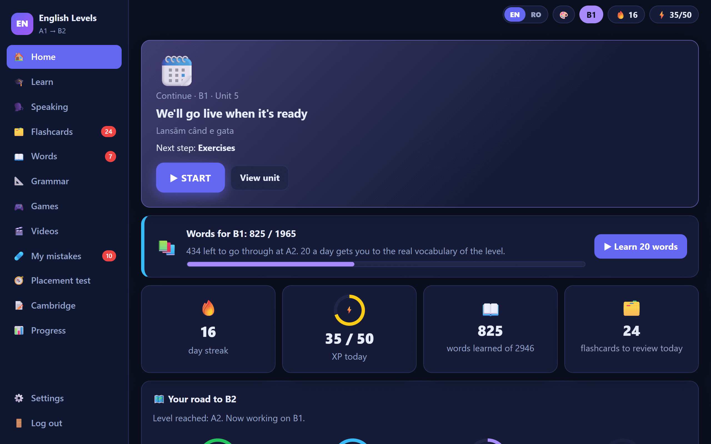 | 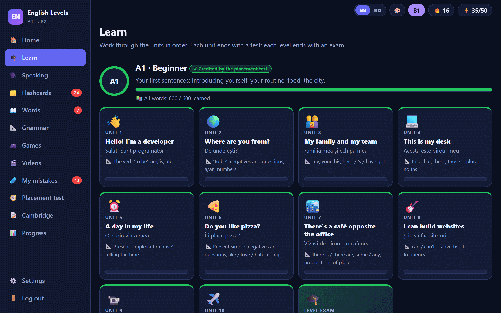 |
| **Home** — what's next, day streak, your road to B2 | **Learn** — units by level and the level exams |
| 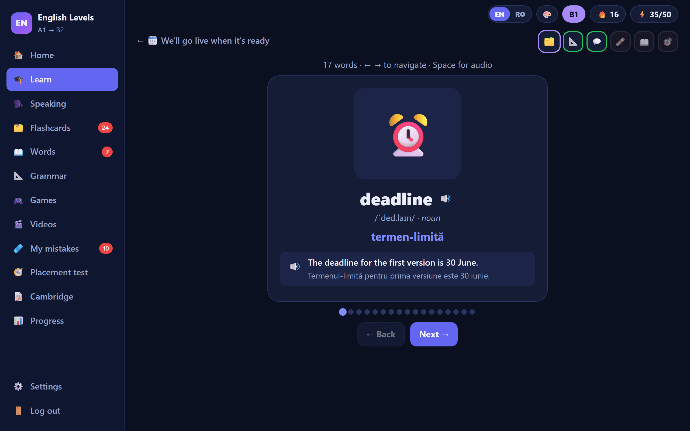 | 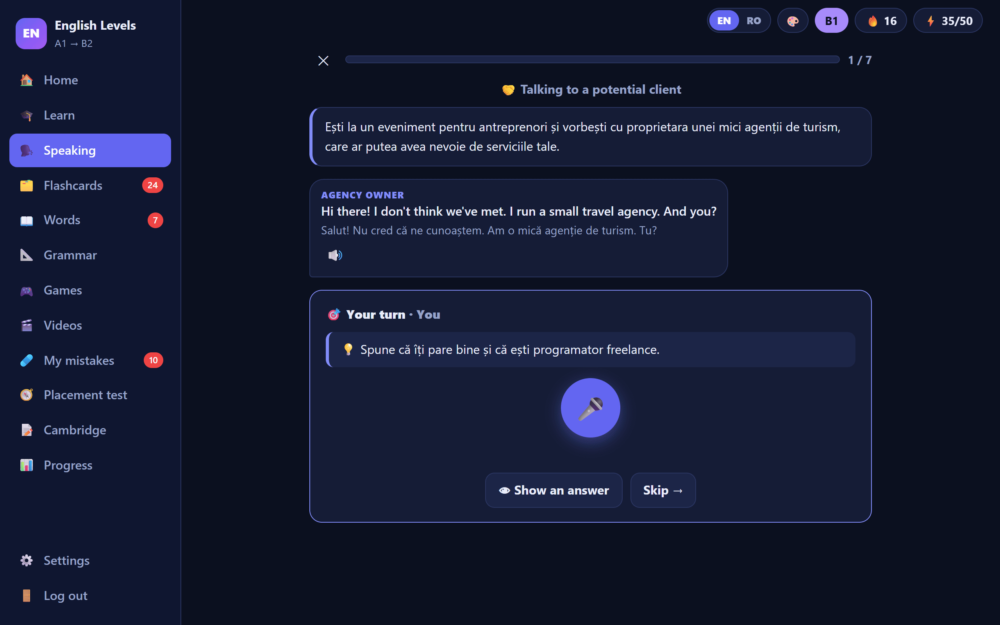 |
| **New words** — picture, pronunciation, example | **Speaking** — conversations where you answer aloud |
| 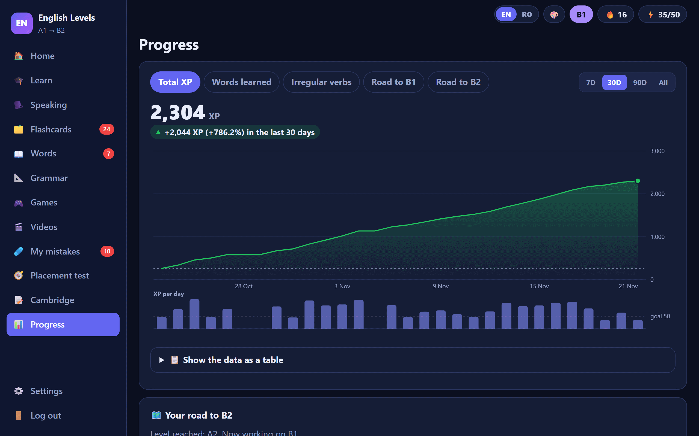 | 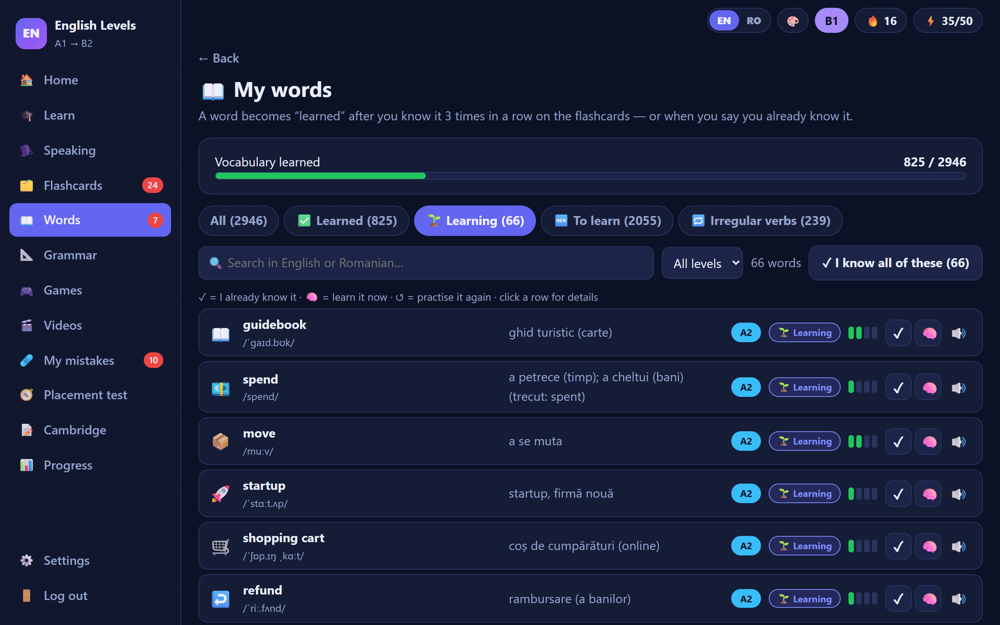 |
| **Progress** — daily chart, crypto-style | **Words** — learned / learning / to learn |
| 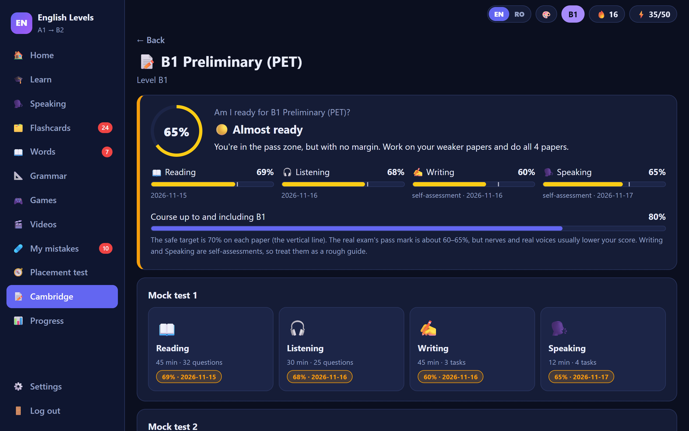 | 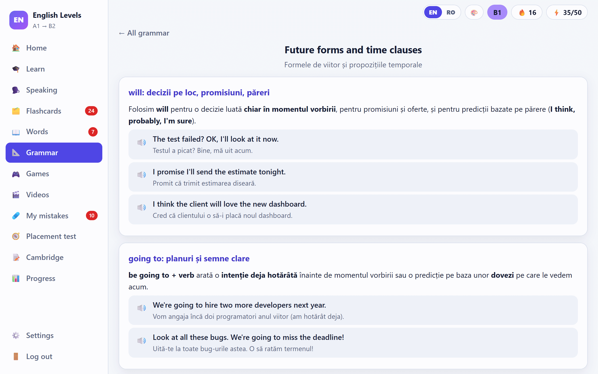 |
| **Cambridge** — "am I ready for the exam?" | **Grammar** explained in Romanian (light theme) |
| 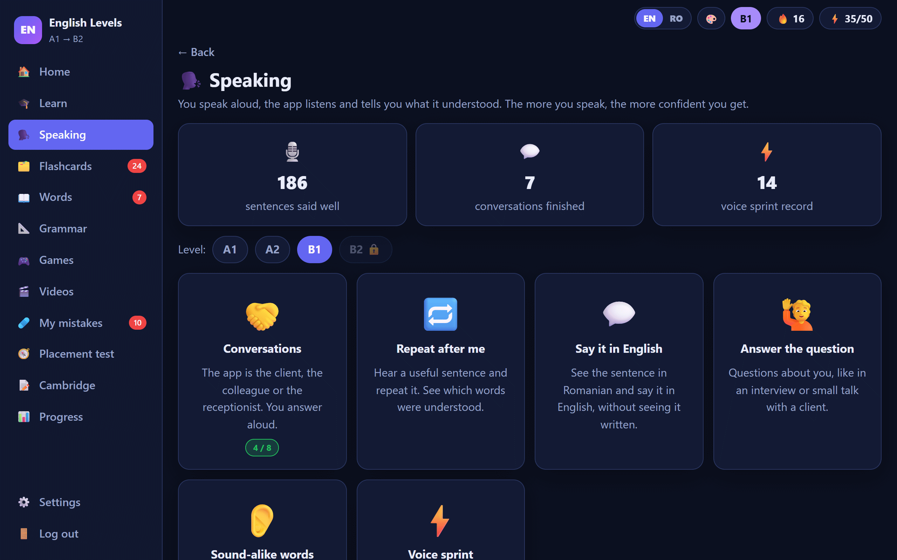 | 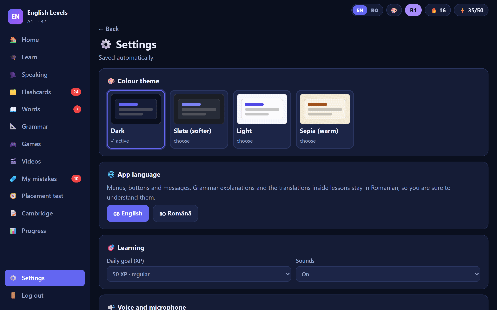 |
| **Speaking** — seven ways to practise aloud | **Settings** — 4 colour themes, EN / RO, voice |
| 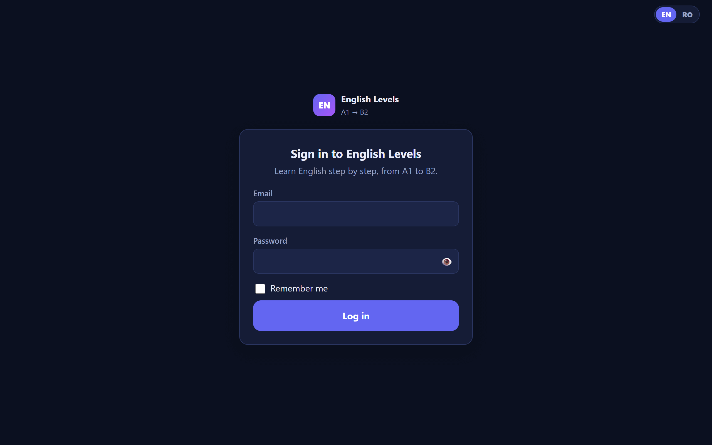 | 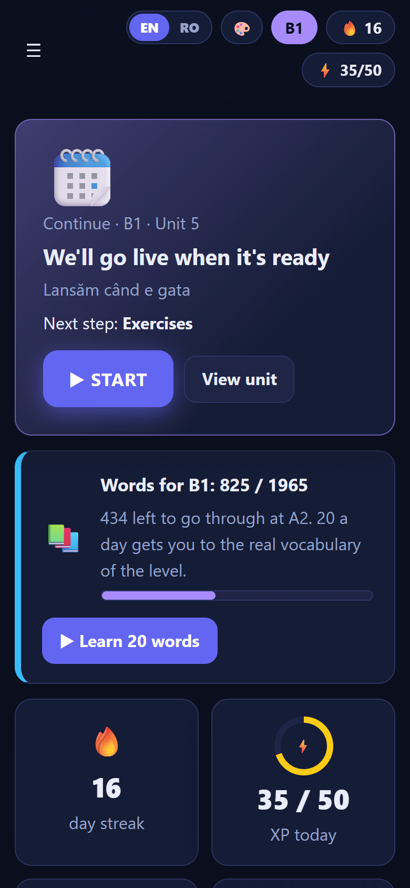 |
| **Login** — one account, from `.env` | **On a phone** |

<sub>The screenshots were taken with demo data (a learner in the middle of B1 after five weeks), not with my own progress.</sub>

## What's inside

- **A1 → B2 course:** 40 units, 10 per level. Each has new words, grammar explained in Romanian, a dialogue, exercises, a reading text and a final test. Half of each test is new questions — the same grammar and words in sentences you haven't seen in the unit — so it checks understanding, not memory. A unit test is passed from 80%; a failed level exam sends the weak units back to review.
- **Content:** about 2,950 words (a CEFR-sized vocabulary: ~600 by the end of A1, ~1,200 by A2, ~2,000 by B1, ~3,000 by B2), 960 exercises of 6 types (multiple choice, fill the gap, word order, translation, dictation, matching pairs), 480 new test questions and 40 recommended videos (one per unit, each with a presenter on camera).
- **Placement test** at the start, so you can skip what you already know. The words of the skipped levels can be checked quickly or marked as known.
- **Speaking:**
  - 32 conversations (client, interview, negotiation, hotel, airport);
  - 240 phrases to repeat;
  - interview-style questions;
  - sound-alike word pairs (*ship / sheep*);
  - a voice sprint;
  - role-play from the lesson dialogues.
- **Word bank** in every unit: besides its 16–18 core words, each unit has 40–85 more common words of its level. You go through them 20 at a time ("I knew it" / "new for me"); the new ones go into the flashcards, the known ones come back once a week later as a check.
- **Irregular verbs:** 239 verbs with their three forms (go – went – gone), most used first, with a full explanation of when each form is used, as a tab of the Words page with search. You learn them 10 at a time by typing the past simple and the past participle (or test yourself first and skip the ones you know); they come back with spaced repetition and every correct answer earns XP.
- **Flashcards** with spaced repetition (next review after 1, 3, 7, 14, 30 and 60 days) and a list of every word, where you can mark what you already know or check a whole level quickly.
- **Word games** (memory, sprint, spelling), a "My mistakes" page, 23 achievements, XP, a day streak and a daily goal.
- **Cambridge:** 2 full mock exams each for B1 Preliminary (PET) and B2 First (FCE), all four papers, with an "am I ready?" indicator.
- **Settings:** interface language (EN / RO, English by default), 4 colour themes, daily goal, sounds, voice and speed, and a microphone test.

New in this version:

- **Login:** a single account, created from `.env`; every page needs it. Sign-in attempts are limited to 5 a minute.
- **Progress in a database**, per user, with **backup and restore** in Settings: download it as a `progress.json` file (the same format as the original app) and load it back, or start again from zero.
- **Account:** change your name, email and password in Settings.

## Built with

| Part | Technology |
|---|---|
| Server | Laravel 13, PHP 8.4+ |
| Interface | Inertia 3 + Vue 3 (TypeScript, Options API), the original style sheet kept class for class, Tailwind CSS 4 for layout |
| Build | Vite Plus (`vp`: build, lint, format, unit tests) |
| Routes in Vue | Wayfinder (typed route helpers, no hard-coded URLs) |
| Quality | Pest (PHP tests), Larastan level 7, Pint, `vue-tsc`, front-end unit tests with Vite Plus |
| Text-to-speech | Web Speech API — `speechSynthesis` (Windows / browser voices) |
| Speech recognition | Web Speech API — `SpeechRecognition` in Chrome / Edge |
| Recording | `MediaRecorder` (record yourself and listen back) |
| Word pictures | Wikipedia API (`page/summary`), the emoji until the photo loads |
| Videos | Embedded YouTube (`youtube-nocookie.com`) |
| Progress chart | Hand-drawn SVG, no chart library |
| Database | SQLite locally, MySQL 8 in production |

No paid services and no API keys.

## How it is put together

- **Content is files, progress is database.** The course (units, word banks, tests, speaking, Cambridge mocks, irregular verbs) is JSON under `resources/content/`, read only through `ContentRepository`. Everything the learner does is stored in database tables, per user.
- **The rules live in PHP.** XP, the streak, unlocking of units and levels, pass marks, spaced repetition, exam review, placement, Cambridge readiness and badges are small services in `app/Services/Progress/`, each covered by tests. Their numbers are in `config/learning.php`. The browser never decides what a result is worth.
- **The browser presents.** Vue draws the pages, checks typed answers, speaks, listens and records. When something worth remembering happens, it tells the server through a small JSON progress API, and the answer brings back the fresh XP, streak and menu badges.

The details:

- [`docs/architecture.md`](docs/architecture.md) — the map: principles, folders, shared props, routes, conventions, how to add a page
- [`docs/backend.md`](docs/backend.md) — database tables, the progress services, the progress API
- [`docs/frontend-ui.md`](docs/frontend-ui.md) — style sheet, layout, generic components
- [`docs/frontend-engine.md`](docs/frontend-engine.md) — answer checking, speech, the exercise runner
- [`docs/content/`](docs/content) — the format of the course content

## Getting started

You need PHP 8.4 or newer (with `pdo_sqlite`), Composer 2 and Node.js 22.18 or newer. No database server is needed locally: it uses SQLite. For the speaking exercises use Chrome or Edge.

```bash
git clone https://github.com/BranDavidIonel/LearnEnglishB2Online.git
cd LearnEnglishB2Online
composer setup
```

`composer setup` installs the PHP and npm packages, creates `.env` from `.env.example`, the app key and the SQLite database, runs the migrations and builds the interface.

**The account.** Put your email and password in `.env`: `ADMIN_EMAIL`, `ADMIN_PASSWORD` (and optionally `ADMIN_NAME`). `.env` never goes into git. Then create the account:

```bash
php artisan db:seed
```

With an empty password the seeder makes a random one and prints it once. Running it again with a new password in `.env` updates the account.

**Start it** (web server, queue and Vite with hot reload):

```bash
composer dev
```

Open http://127.0.0.1:8000 and log in with the email and password from `.env`.

**Bringing your progress from the original app** (its `user/progress.json`):

```bash
php artisan progress:import path/to/progress.json
```

It replaces the progress of the admin account (another account: `--email=`). You can also load the file from Settings.

**Backing it up:** Settings → download the progress, or from the command line:

```bash
php artisan progress:export --output=progress.json
```

Import → export gives back the same file, so the backup can always go back into the original app too.

## Tests and checks

```bash
composer test        # Pint, Larastan, content:validate, then the Pest tests
npm run test         # the front-end unit tests (Vite Plus)
composer ci:check    # everything: front-end lint + format, vue-tsc, the front-end tests, then composer test
```

- **Pest — 514 tests** (4,105 assertions, ~25 s, an in-memory SQLite database): every rule of `app/Services/Progress` in `tests/Unit`, every page and every API route in `tests/Feature` (guests sent to the login, page props, validation, the effect on the database), the import / export round trip, the content files and the validator, the login and the account, security headers, and that every interface text has a Romanian translation with the same placeholders.
- **Front end — 160 tests** in 18 files: answer checking, speech recognition matching, the exercise runner, saving progress with retries, the Cambridge papers and other helpers in `resources/js`.
- **Content:** `content:validate` checks all 135 content files (units, word banks, tests, speaking, Cambridge mocks, irregular verbs).

## Adding content

The course is in `resources/content/`:

```
a1/ a2/ b1/ b2/         unit01–10.json, bank01–10.json (word banks), test01–10.json (new test questions),
                        placement.json, speaking.json
verbs.json              the irregular verbs
cambridge/pet|fce/      exam.json, test1.json, test2.json
```

The format is described in [`docs/content/SCHEMA.md`](docs/content/SCHEMA.md) (lessons), [`SCHEMA-SPEAKING.md`](docs/content/SCHEMA-SPEAKING.md) (speaking) and [`SCHEMA-CAMBRIDGE.md`](docs/content/SCHEMA-CAMBRIDGE.md) (exams). After any change, run:

```bash
php artisan content:validate
```

A changed file is picked up by itself: what the app derives from the content is cached under a fingerprint of the files.

## Project structure

```
app/
  Console/Commands/       content:validate, progress:import, progress:export
  Enums/                  Level, UnitStep, Theme, WordStatus, Game …
  Http/Controllers/       one thin controller per area; Api/ is the JSON progress API
  Http/Requests/          validation of every write
  Http/Resources/         the shapes sent to the pages
  Models/                 the learner's data
  Services/Content/       ContentRepository and the content validator
  Services/Progress/      the rules: XP, course, exams, words, verbs, mistakes, Cambridge, badges …
config/learning.php       the admin account, the content path, the numbers of the rules
resources/
  content/                the course (JSON)
  css/                    the ported style sheet, split by subject
  js/pages/               one Vue page per screen
  js/components/          general, layout, exercise, speech, content, charts, modules/<area>
  js/api/progress.ts      typed calls to the progress API
  js/i18n/ro/             Romanian interface texts (lang/ro.json for the shared ones)
routes/web.php            login and language; routes/web/<area>.php, all behind the login
tests/                    Pest: Unit (the rules) and Feature (pages, API, import / export)
docs/                     architecture, back end, front end, content format, screenshots
```

## Deployment

The live site is deployed with [AutoDeploy](https://github.com/BranDavidIonel/AutoDeploy), my deploy tool for Laravel: every release goes into its own folder and the switch is instant, so there is no downtime. Before a release goes live, `php artisan content:validate` and the migrations run in it; if one fails, the site stays on the previous release. A push to `main` starts the deploy.

## Good to know

- The lessons, conversations and mock exams were written with the help of AI (Claude) and **have not been checked by a teacher**. If you find a mistake, fix it in the JSON file and run `php artisan content:validate`.
- The Cambridge mock exams are original material that only follows the **format** of the real exams. For a final check, also use the official sample tests on the Cambridge website. Writing and Speaking are marked by yourself.
- Speech recognition checks whether it understood you; it does not grade your accent.
- Speech recognition needs Chrome or Edge (it is not available in Firefox), and the microphone needs HTTPS or localhost.
